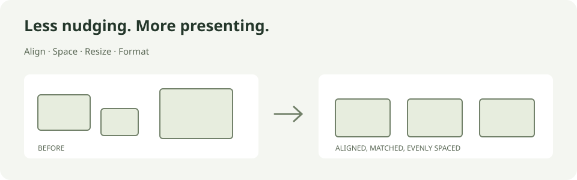

# Free Elements

**A small, free PowerPoint toolkit for Mac.** Align shapes, fix spacing, match sizes, and clean up formatting from one compact native palette.

[](https://github.com/markperdomo/free-elements/actions/workflows/ci.yml)
[](LICENSE)

[Download for Mac](https://github.com/markperdomo/free-elements/releases) · [Installation](docs/MAC_INSTALL.md) · [Tool guide](docs/USAGE.md) · [Report a problem](https://github.com/markperdomo/free-elements/issues/new/choose)



## What it does

- **Position:** align to a reference shape, selection bounds, or the slide.
- **Spacing:** equal or fixed gaps, grids, and two-shape swaps.
- **Size:** match width, height, or both, keeping centers or top-left corners fixed.
- **Shape:** chevron process chains, matching adjustment handles, arrow proportions, and consistent corner radii.
- **Format:** copy or apply fill, outline, and font independently; save local presets.
- **Text:** margins, wrapping, autofit, bullets, numbering, indentation, and split/merge into editable copies.

The native version runs inside PowerPoint using VBA and Swift/AppKit. It needs no web server, account, subscription, or Node.js runtime. There is no telemetry or backend. Microsoft PowerPoint is a separate requirement.

## Install on Mac

1. Download **`FreeElements-0.2.2-macOS.pkg`** from [Releases](https://github.com/markperdomo/free-elements/releases/tag/v0.2.2).
2. Save your presentations and **quit PowerPoint**. Run the installer; it asks for administrator permission to install in Office's shared add-ins folder.
3. Open PowerPoint → **Tools → PowerPoint Add-ins → +**. Press **⌘⇧G** in the file chooser and enter:

   ```text
   /Library/Application Support/Microsoft/Office365/User Content.localized/Add-Ins.localized/Free Elements/Program/
   ```

4. Select **FreeElements.ppam**, load it, then choose **Home → Free Elements**.

**This is an unsigned, unnotarized prerelease.** macOS may block the installer; see [installation and troubleshooting](docs/MAC_INSTALL.md) before proceeding. Keep PowerPoint's macro protection enabled and approve only this add-in if you trust the source. Organization policy may prevent installation.

The package has passed build and integrity checks. Clean-machine installation, Intel execution, and the new window attachment mode still need live testing; see [validation](docs/VALIDATION.md).

## Try it

Open a copy of a presentation and select several unrotated shapes. Choose a reference, click **Match width and height**, **Align top**, then **Equal horizontal gaps**. Hover over an icon to see its action. Use **⌘Z with the slide focused** to undo.

For an exact reference, select one shape, click **Pin**, then add the other shapes to the selection. [The tool guide](docs/USAGE.md) explains references, presets, and text-copy behavior.

## Compatibility and status

| | Support |
| --- | --- |
| macOS | Native binary targets macOS 12+; your PowerPoint version may require a newer OS |
| PowerPoint | Desktop PowerPoint for Mac with VBA; locally tested with 16.113.2 (LTSC 2024) |
| Apple Silicon | Native engine tested in PowerPoint |
| Intel | Universal binary includes x86_64; live Intel testing is still needed |
| Windows / PowerPoint web | No native add-in; an experimental Office.js implementation is included in source |
| Shape support | Unrotated AutoShapes, text boxes, and text placeholders |

Early software: groups, pictures, charts, tables, rotated shapes, and rich-text format capture are outside the current native scope. Split/merge keeps the originals and creates plain-text copies. See [validation](docs/VALIDATION.md) for exactly what was tested, and [the changelog](CHANGELOG.md) for release differences.

## Run the browser playground

The playground lets you try the tools on a sample slide without PowerPoint. Install Node.js 20+ and run:

```sh
git clone https://github.com/markperdomo/free-elements.git
cd free-elements
npm start
```

Open [localhost:4317](http://localhost:4317). There are no npm dependencies to install. Stop with Ctrl+C. This edits the sample slide; it is not a PPTX editor. See the [web tool guide](docs/WEB_PLAYGROUND.md) and [Office.js development setup](docs/INSTALLATION.md).

## Build and contribute

```sh
npm test
python3 -m unittest discover -s native/tests -p 'test_*.py'
```

For native builds, you also need macOS, Xcode command-line tools, Python 3.10+, and PowerPoint to compile/export the VBA project. Start with the [native build guide](docs/NATIVE.md) or [contribution guide](CONTRIBUTING.md). [Release instructions](docs/RELEASING.md) cover installer builds, checksums, and signing.

## License

[MIT licensed](LICENSE). Free Elements is not affiliated with or endorsed by Microsoft. Microsoft PowerPoint is a separate product and is required for the native add-in.
