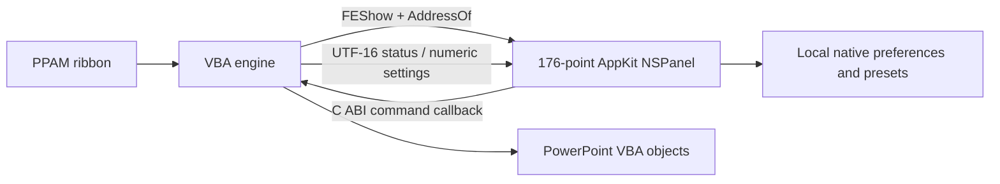
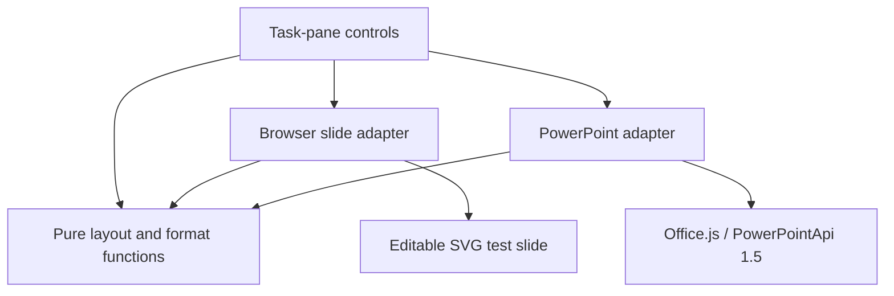

# Free Elements integration design

## Native Mac implementation and web prototype

The native implementation is in `native/vba/` and `native/macos/`. It implements layout and formatting operations through PowerPoint's VBA object model and uses a Swift/AppKit palette in the PowerPoint process. The Office.js adapter and browser playground remain a separate implementation and test environment.



No network server, WebView, AppleScript, helper process, launch agent, or private Office database is involved in the native route. The bundle exports a narrow C ABI: `FEShow`, `FEHide`, `FEValue`, `FESetValue`, `FEStatus`, `FECopyText`, and `FESetText`. Integer command IDs and bounded UTF-16 buffers avoid transferring VBA-owned string objects into Swift. AppKit controls and callbacks stay on PowerPoint's main thread. A reentrancy guard prevents nested commands; unload hides the panel and clears the callback before VBA teardown.

`Auto_Open` registers events only; it does not display or load the native palette. The ribbon opens the palette on demand. Native close and presentation-close events clear the callback, and the palette does not force itself to become the key window.

`FEEvents` observes PowerPoint selection changes. Each command re-reads the selection, checks shape type and rotation, then uses fresh geometry. Pinned references retain both presentation and slide context and must remain in the selection for commands that need them. Layout operations calculate all coordinates before writes and retain geometry/aspect-lock snapshots for rollback. Text-copy operations retain original shapes and remove newly created copies if creation fails.

The development install uses:

```text
~/Library/Group Containers/UBF8T346G9.Office/Free Elements/Program/
  FreeElements.ppam
  FreeElements-0.2.2.bundle/
  build.json
```

The Office group container allows native library loading inside PowerPoint's sandbox. Terminal access may still be blocked by macOS privacy controls; Finder can perform the narrowly scoped file copy. The build generates user-specific `Declare Lib` paths. Distribution builds use the fixed shared installation path in [MAC_INSTALL.md](MAC_INSTALL.md). Clean-machine installation still needs live validation; the current prerelease is unsigned and unnotarized. Native defaults and format presets use the `org.freeelements.palette` suite; web presets remain separate.

PowerPoint itself must compile/serialize the VBA project. `package-native.py` validates the resulting PPAM, copies its VBA bytes unchanged, and adds our ribbon XML. `install-native.py` stages or copies only owned files; registration uses **Tools → PowerPoint Add-ins**. Updates must not overwrite a mapped bundle in a running PowerPoint session. A versioned bundle name provides a safe separation between releases.

See [native instructions](NATIVE.md) for current build/delivery status and the distinction between native compilation, host checks, and final add-in registration.

## Web implementation

## Current code structure



- `src/core/layout.js`: immutable transforms in points. An operation either validates and returns a result or throws before any write is scheduled.
- `src/core/format.js`: format validation and selective property merging; preset parsing tolerates corrupted storage.
- `src/core/shape.js`: physical corner radii and arrowhead depths, angle matching, normalized handle copying, and reference-anchored chevron chains.
- `src/core/text.js`: selective text-frame/paragraph patches, deterministic text-copy plans, and approximate browser text layout. PowerPoint performs its own native text layout.
- `src/adapters/demo.js`: sample slide, selection, drag commits, bounded undo/redo history.
- `src/adapters/powerpoint.js`: selection snapshots scoped by presentation and slide; operations re-read geometry and verify that the selected IDs still match. It writes only changed geometry properties and explicitly requested style properties.
- `src/app.js`: controls, reference selection, preset storage, SVG rendering and export. The Office runtime loads only in explicit PowerPoint mode. A failed Office connection never silently edits the sample slide.
- `scripts/serve.mjs`: loopback-only static server for the app and source modules. The installer, research, certificates, and other workspace files are not public routes.

## Defined behavior

Alignment keeps the explicit reference fixed. Selection-bounds alignment uses the outside envelope. Equal-gap distribution sorts along the chosen axis, fixes the two outside shapes, and equalizes edge-to-edge distances. Insufficient space is rejected; fixed spacing can expand the arrangement. Equal coordinate ties are ordered deterministically by ID.

Match-size commands support center and top-left anchors; they do not preserve aspect ratio when matching width or height alone. A two-shape swap exchanges centers without exchanging dimensions. Grid uses top/left ordering and cells sized to the largest selected dimensions. Fixed spacing and grids can move shapes outside the slide; this version does not constrain the layout to slide bounds.

Format capture intentionally supports only opaque solid fills, visible solid single outlines, and uniform text attributes. Gradient, mixed-font, and transparent source styles are rejected instead of pretending to copy them completely. Format application sets only the selected fill/outline/font values; it is not a full fidelity format painter.

The PowerPoint adapter preflights selections, shape types, and values. Office batches are not guaranteed to be atomic, and there is a small race between reading and writing if the document changes concurrently. Real-host undo behavior needs validation; the UI directs users to PowerPoint's Undo if a host write fails. Browser undo does not claim to undo Office changes.

## Next milestones

1. Run the real Mac host acceptance checklist. Resolve sandbox, selection, font, and undo behavior before calling the add-in production ready.
2. Add pictures and placeholders with appropriate geometry/format capability checks; handle aspect-ratio locks and rotated visual bounds.
3. Add position/size capture, docking/stretching, spacing increments, richer format capture, theme colors, and richer text manipulation.
4. Add a reusable element library and agenda generation once the editing layer is dependable.
5. Finish native PPAM deployment verification and validate signed builds on Intel and other supported Office versions.

Microsoft references: [shape APIs](https://learn.microsoft.com/en-us/office/dev/add-ins/powerpoint/shapes), [selection API set 1.5](https://learn.microsoft.com/en-us/javascript/api/requirement-sets/powerpoint/powerpoint-api-1-5-requirement-set), [Mac sideloading](https://learn.microsoft.com/en-us/office/dev/add-ins/testing/sideload-an-office-add-in-on-mac), and [PowerPoint add-in loading](https://support.microsoft.com/en-us/powerpoint/add-or-load-a-powerpoint-add-in).

## Web Shape and Text contracts

Shape commands require unrotated native AutoShapes and an explicit kind (Chevron, RightArrow, or RoundRectangle). The adapter reads every adjustment and checks its count before any writes. Office.js exposes adjustment values but not the AutoShape preset, so the selected kind must match the actual shapes; count checking cannot distinguish every preset. Radius and head depth use `adjustment × min(width, height)`; arrow shaft thickness is a height fraction. Chain spacing is measured between corresponding angled edges and may overlap rectangular bounding boxes. The chosen reference is fixed.

Text-frame writes preserve text runs, font settings, and unrelated properties. Split/merge intentionally create new plain-text boxes offset 12 points from the originals. They never delete or rewrite the sources. Copies use the current Format font settings; hyperlinks, mixed runs, and original paragraph styles remain only in the source boxes. Splitting occurs at paragraph boundaries, including blank paragraphs; merging uses visual top/left order. Shape creation finishes before selecting the new IDs (selection requires API 1.6). A native Undo with slide focus removes the merged copy in one action on the tested Mac.

API 1.10 tools are checked both in the UI and adapter. PowerPoint for Mac resets numbering when `bulletFormat.visible` is written last, so visibility is queued before `type` and `style`. Relevant primary references: [Adjustments](https://learn.microsoft.com/en-us/javascript/api/powerpoint/powerpoint.adjustments), [TextFrame](https://learn.microsoft.com/en-us/javascript/api/powerpoint/powerpoint.textframe), [BulletFormat](https://learn.microsoft.com/en-us/javascript/api/powerpoint/powerpoint.bulletformat), and [requirement-set support](https://learn.microsoft.com/en-us/javascript/api/requirement-sets/powerpoint/powerpoint-api-requirement-sets).
